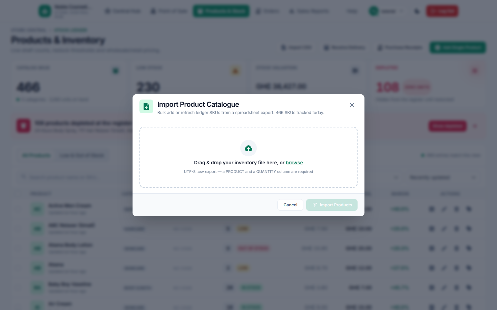

# 03 — Bring the catalogue in

## What this is for

This is how the shop's shelf list gets filled. You either hand the till a spreadsheet of
everything you now stock, or you type one new item in while it is still in the box from the
supplier. Both routes end in the same place: a row in the Products & Inventory ledger, with a
count, a wholesale cost, a retail price and a category.

## You need

- **Role.** The owner's account, for both dialogs. A cashier who reaches either address is
  bounced to the sign-in page — the same page a dead session lands on, so the screen will not
  tell them which of the two happened.
- **Screen.** Two dialogs over the **Products & Inventory** ledger: **Import Product
  Catalogue**, opened by the toolbar's **Import CSV** button, and **Add New Product**, opened
  by the toolbar's **Add Single Product** button.
- **How to get there.** Sign in as the owner, open **Products & Stock** in the header — or use
  the hub's **+ Add New Product** button beside the welcome card, which lands on the ledger
  with the one-item dialog already open.
- **Data that must already exist.** For the spreadsheet route: a UTF-8 `.csv` whose first line
  is the header row. The columns the dialog looks for are `PRODUCT`, `QUANTITY`,
  `COST PRICE`, `SELLING PRICE`, and optionally `SKU` and `CATEGORY`. An export of the shop's
  own catalogue file works; its extra columns are ignored. For the one-item route: nothing —
  an empty title box is a valid starting point.
- **And for the spreadsheet route only:** the background worker running. The import is handed
  to it, so with the worker down the request just sits there. The one-item dialog does not
  need it: its opening units are booked the moment you press save.

## Steps

### 1. Open the import dialog

From the ledger toolbar, press **Import CSV**. The dialog drops over the table, and the
ledger behind it is dimmed and blurred — its rows are shapes, not readable text.

What the frame says, and what it means at the counter:

- The subtitle reads "Bulk add or refresh ledger SKUs from a spreadsheet export. 466 SKUs
  tracked today." That number is the whole ledger, not today's work; the wording is the
  screen's, not a daily figure.
- The dropzone reads "Drag & drop your inventory file here, or browse". Either gesture does
  the same thing — you are choosing a file.
- Under it: "UTF-8 .csv export — a PRODUCT and a QUANTITY column are required".
- The green **Import Products** button at the bottom right is pale and unclickable while no
  file is loaded. **Cancel** closes the dialog and touches nothing.

### 2. Load the file and read what the dialog detected

Drop the file onto the dashed box. The box is replaced by a file card showing the name, its
size in KB and the row count, one of the words "reading file…", "schema verified" or
"schema incomplete", and a **Ready to import** pill once the columns pass. Below that, a panel
headed "Automatic field mapping" lists the six column names it knows about, each as a chip:
white for a column your file has, red for one it is missing, with "N of 6 columns found" at
the right. A small trash icon on the file card clears the choice and puts the empty dropzone
back. There is no screenshot of this frame; it is described here rather than shown.

### 3. Decide what happens to items the ledger already has

Under "Import directive" there is one checkbox: "Update the product when the SKU already
exists", and under it "Matched rows overwrite name, category, prices and shelf count. Left
off, a row whose name is taken is skipped." Tick it when the spreadsheet is a refresh of
names, prices or categories for lines you already stock. Do not tick it to move a count: on a
row the ledger already has, the `QUANTITY` column is read and then dropped, and the shelf
keeps whatever number it had. A count that is wrong gets corrected on the row itself, in
chapter 06 — never through this dialog. Leave the box off when the file is only new lines.
Both sentences under it are wrong somewhere, and the last section of this chapter says which.

### 4. Press the button

The button label counts your rows — "Import 120 Products" for a 120-row file — and changes to
"Importing…" while the request is in flight. **The step ends at the button.** What happens
after it is described in words: the file is handed to the worker, the dialog is replaced by a
progress dialog headed "Importing Products" with a bar and the task's first eight characters
under the title, and that dialog keeps re-asking the shop for the task's state until the
worker reports back. It runs to
"Validating catalogue import", then "Catalogue import complete", then the heading becomes
"Import Complete" with the line "The worker finished. The ledger behind this dialog already
shows the new rows." and a **Back to ledger** button. There is no screenshot of that dialog:
the captures for this chapter were taken without writing to the shop's data, so no import was
ever run in front of a camera.

### 5. For one item, open the product dialog instead

Close the import dialog and press **Add Single Product** on the same toolbar.

Walk it top to bottom:

- **Product Title** is the only line the customer ever sees; the note beside it reads "Shown
  on POS receipts and the register grid". The grey example inside the box — "e.g. Radiance
  Vitamin C Brightening Serum (50ml)" — is a placeholder, not a saved name. Names must be
  unique across the ledger.
- **Category** holds the five the shop has: Skincare, Makeup, Haircare, Fragrance, Body &
  Bath. There is no screen for adding a sixth.
- **SKU / Barcode ID** is optional, and the box opens genuinely empty: the grey `NC-SK-0000`
  in it is a placeholder hint, not a code waiting to be saved, and it does not follow the
  category you pick. Nothing is stored if you save without typing. **AUTO-GEN SKU**, top right
  of that box, types a code in for you: there the prefix does follow the category you have
  selected — `NC-SK-`, `NC-MK-`, `NC-HC-`, `NC-FR-`, `NC-BD-` — plus four random digits. Leave
  the box empty and the ledger row reads "No code", which is what most of the 466 rows in
  these screenshots say.
- **Shelf Photo** reads "Optional — shows in the ledger and on the register tiles", with
  **Choose image** beside a grey slot. The small print: "Square or portrait photos look best.
  JPG, PNG, WebP or GIF, capped at 5 MB; oversized files are downscaled on save."
- **Initial Physical Stock (Units)** is a three-part control: a minus button, the number, a
  plus button. It is the count on the shelf the moment the item is saved.
- **Low-Stock Threshold** ships at 5 with "UNITS MIN" inside the box and "Triggers the
  restock alert" beside the label. The ledger pill turns amber at or under this number, and
  goes red the moment the count reaches zero.
- **Unit Pricing & Margin Engine** holds **Wholesale Cost Price** and **Retail Selling
  Price**, both prefixed `GH₵`, with "Currency: GH₵ (Ghana Cedi)" at the top right. As you
  type, the strip under them recalculates: "Est. unit gross profit" as `GH₵ 0.00 / unit`, a
  margin pill reading "+0.0% Margin", and "Lot valuation (0 units)" split into
  "`GH₵ 0.00` retail • `GH₵ 0.00` cost". The margin pill turns red when the price is under
  the cost.

### 6. Save it

Press **Add Product to Inventory**. **The step ends at the button**, and what happens after it
is described in words: a card replaces the dialog, headed "Ledger updated" with the line "The
stock table behind this dialog already shows the change." and the sentence
"`<name>` was added to the stock ledger.", and **Back to ledger** closes it. Any units you
typed in the stock box are booked as opening stock, not as a delivery from a supplier. There
is no screenshot of that card, for the same reason as step 4.

## When it goes wrong

- **"Choose a .csv file to import."** — a red band at the top of the import dialog. The form
  was sent with no file attached; the browser's own gate usually stops this, so seeing it
  means the dialog was submitted from a corner of the screen that bypasses it.
- **"That file could not be read as a UTF-8 CSV."** — the file opened but is not text the shop
  can parse: a workbook saved under a different name, or a CSV exported in a local encoding.
  Re-export it as "CSV UTF-8".
- **"No product rows found. A PRODUCT column is required."** — the file opened but held no
  data lines, e.g. a header row only.
- **"schema incomplete"** on the file card, and **"Missing PRODUCT, QUANTITY — the import
  cannot map those fields."** under the mapping chips. The list between "Missing" and the dash
  is exactly the required headers your first line does not contain. The comparison is
  letter-for-letter, so `Product` in lower case counts as missing.
- **"The browser could not read that file as text."** — the file card's own failure line; the
  mapping panel never appears and the submit button stays pale.
- **The pale button, with no message.** While a required column is missing, the import button
  is disabled and greyed. It may still count your rows — "Import 120 Products" — so the label
  alone does not tell you the file was refused; the reason is the red chips and the "Missing
  …" line above it.
- **"Importing Products" with the bar at 0% and the word "Waiting for the worker…"** under it,
  and nothing moving. That is the background worker being down, not a slow file. The import
  will not start until the worker is back; see chapter 13.
- **"Import Failed"** as the heading, with a red band under the bar carrying the worker's own
  exception text — the row sentence inside it, wrapped in the exception's quotes and brackets,
  such as **"['Row 3: product already exists; enable update existing.']"**, **"['Row 12:
  quantity must be a whole number.']"**, **"['Row 2: duplicate product name.']"** or
  **"['Row 5: CATEGORY is not recognized.']"**. One bad row stops the whole file and nothing
  is written; fix the sheet and send it again.
- Inside the product dialog, a single line of red under the box that refused you:
  **"Acquisition cost cannot be negative."**, **"Selling price cannot be negative."**,
  **"Image is larger than 5 MB. Pick a smaller file."**, **"Unsupported image type. Use JPG,
  PNG, WebP or GIF."**, **"This file is not a readable image."**
- **A name or a code that is already taken.** This is the ordinary way the product dialog
  refuses you, and it never leaves the dialog: the box keeps its red line —
  **"Product with this Name already exists."**, or **"Product with this Sku already
  exists."** when it is the code that clashes — and the rest of the form stays as you left it.
  Change the name, or press **AUTO-GEN SKU** again, and save. Nothing is written and nothing
  is lost while you do.
- **"Nothing was saved"** as the card heading, with **"New product could not be saved. Try
  again later."** under it. This is the database refusing the write after every check inside
  the dialog had passed — a genuinely rare failure, and not the duplicate name or code above,
  which the dialog catches on its own before it ever gets here.
- **The checkbox that is not there.** The photo slot only grows a "Remove current image"
  checkbox when the product already has a photo stored, and its button reads "Replace image"
  instead of "Choose image". On a brand-new product there is nothing to remove, so no option
  appears.

## Notes & limits

- **There is no preview and no column mapper.** The dialog reads your header line and tells
  you which of its six known columns it found. You cannot point a differently named column at
  a field, and you never see a single row of data before you press the button. Rename the
  columns in the spreadsheet instead.
- **The dropzone hint under-names the requirement.** "a PRODUCT and a QUANTITY column are
  required" is what the box says; the gate that enables the button also demands `COST PRICE`
  and `SELLING PRICE`.
- **"Left off, a row whose name is taken is skipped" is not what the code does.** With the
  checkbox off, a row that matches an existing product raises a refusal for that row, and
  because the import is one transaction the entire file rolls back. Nothing is skipped and
  nothing is half-written.
- **"Matched rows overwrite name, category, prices and shelf count" keeps three of the four,
  and the one it drops is the last.** On a row that matches a product already in the ledger,
  the ticked box rewrites the name, the code, the category, the cost and the selling price —
  and the `QUANTITY` on that row is dropped: no batch is created and the shelf keeps whatever
  count it had. So this checkbox is for a catalogue whose words or prices changed, not for one
  that counts the shelf. Only genuinely new lines get their quantity booked. If you were
  counting on a spreadsheet to set someone's shelf count, it will not: that is a counted
  correction (chapter 06), or a delivery (chapter 05) when a supplier really brought units.
- **The checkbox matches on more than the SKU.** A row is treated as existing when its SKU
  *or* its name (ignoring letter case) is already in the ledger, so a re-typed name with a new
  SKU updates the old row rather than adding one.
- **The import writes a new line's count as an opening movement**, not as a delivery from a
  supplier: its own reason line reads "Catalogue import opening quantity; not a purchase
  receipt." The one-item dialog does the same trick with "Initial stock entered when the
  product was created." It is still real paperwork: each booked line leaves a row in Purchase
  Receipts wearing the violet "Imported opening balance" label, with a batch behind it — and
  that batch is one of the records chapter 07 refuses to delete. Deliveries with a supplier
  and an invoice belong to chapter 05.
- **Quantities must be whole numbers**, and a blank `CATEGORY` lands the item in Skincare.
- **`SKU / Barcode ID` is a shelf label, not a scanner feed.** Nothing in the shop reads a
  barcode; the register finds items by name. Codes are stored in upper case whatever you type.
- **Auto-gen SKU does not check the ledger.** It draws four random digits; a clash is refused
  at save time, not avoided at typing time — and the refusal keeps the dialog open with its
  red line under the box, so pressing **AUTO-GEN SKU** again is all it takes.
- **The dialog will never fix a count later.** Once an item is stocked, this form is for
  prices, category, threshold and photo. Stock moves through a delivery or a counted
  correction.
- **"466 SKUs tracked today."** is the ledger's total, refreshed when the dialog opens.
- **A blank `LOT VALUATION (0 UNITS)` line is normal** while the stock box still reads 0.
- **What only the other role sees:** none of this. A cashier's screen world is the register.
  If the owner is away, a new line cannot be added, and there is no request queue for it.

Related chapters: 02 for the hub, 04 for the ledger this feeds, 05 for deliveries with a
supplier behind them, 06 for correcting a count, 07 for taking a line back out, 13 for the
worker.
