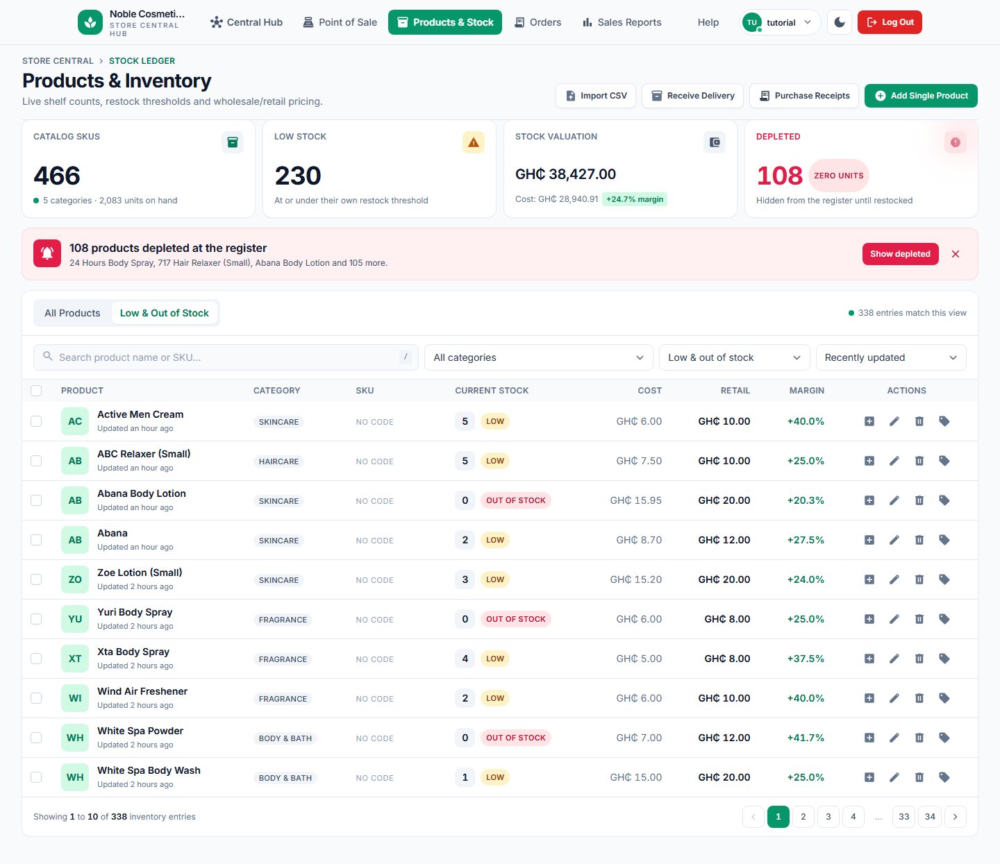

# 04 — Read the Products & Stock ledger

## What this is for

This is the screen that answers the two questions the shop runs on: how many of each thing
are actually on the shelf, and what they would be worth if they all sold at the ticket price.
It is also where you find the items that have run out, the ones about to run out, and the
price you are charging for each.

## You need

- **Role.** The owner's account. This is an owner screen; a cashier who reaches the address is
  bounced to the sign-in page and gets no message about permission.
- **Screen.** **Products & Inventory**, the page under the header tab **Products & Stock**,
  with the crumb "STORE CENTRAL › STOCK LEDGER" above its title.
- **How to get there.** Sign in as the owner and press **Products & Stock**. To start on the
  empty shelves instead, the hub's Products & Inventory card carries a **Restock Alerts (N)**
  button and the low-stock tile has an **Order Stock Now** link; both open this same page
  already filtered to the low and depleted rows.
- **Data that must already exist.** At least one product, which in practice means chapter 03
  has been run. An empty ledger is a valid state and shows the empty panel described below,
  not an error. Against a shop that has been running a while you should expect hundreds of
  rows, most of them without a code — the ledger these frames were taken from holds 466
  products, so a fresh till has the same shape with different numbers.

## Steps

### 1. Read the page top to bottom

The ledger opens on "All Products", sorted by what was touched last.

- **The four tiles.** "CATALOG SKUS 466" with "5 categories · 2,083 units on hand" under it.
  "LOW STOCK 230" with "At or under their own restock threshold". "STOCK VALUATION
  GH₵ 38,427.00" with "Cost: GH₵ 28,940.91" and a "+24.7% margin" chip. "DEPLETED 108" with a
  "ZERO UNITS" chip and "Hidden from the register until restocked".
- **The red banner** under the tiles: "108 products depleted at the register", then three of
  their names and the rest as a count — "24 Hours Body Spray, 717 Hair Relaxer (Small), Abana
  Body Lotion and 105 more." — with **Show depleted** on the right and a plain close cross
  that only hides the banner for the moment.
- **The tabs:** "All Products" and "Low & Out of Stock". At the right of that strip, a live
  count: "466 entries match this view".
- **The filter row:** the search box ("Search product name or SKU…" with a `/` key hint
  inside it), a category picker ("All categories", then the five), a stock-status picker
  ("All inventory", "Low & out of stock", "In stock", "Low stock", "Out of stock") and a sort
  picker ("Recently updated", "Stock: low to high", "Stock: high to low", "Price: high to
  low", "Highest margin").
- **The table:** PRODUCT (name, with a relative "Updated …" line under it — "Updated an hour
  ago" on six rows here and "Updated 2 hours ago" on the other four), CATEGORY, SKU, CURRENT
  STOCK, COST, RETAIL, MARGIN, ACTIONS. Most rows read "NO CODE" in the SKU column, because
  the catalogue was imported without codes.
- **The stock cell** is three things: the number itself, which is a button; a status pill —
  "IN STOCK" green, "LOW" amber, "OUT OF STOCK" red; and nothing else. The pill is decided by
  comparing the count with that product's own threshold, so a "LOW" of 5 units and a "LOW" of
  1 unit are both simply at or under their own line.
- **The action icons**, four per row: a plus box for restocking, a pencil for editing, a bin
  for removing, and a tag for the batch history.
- **The pager** at the bottom: "Showing 1 to 10 of 466 inventory entries" and the page strip
  "1 2 3 4 … 46 47". Ten rows to a page on every link this screen offers — the page size is
  carried along by the table, the tabs, the filters and the pager, so you only ever see ten
  unless something else asks for a different number.

### 2. Press "Show depleted", or switch to the other tab

To see only what needs ordering, use the banner's **Show depleted** for the empty ones, or
the "Low & Out of Stock" tab for everything at or under its threshold.

The tiles above do not change — they always describe the whole shop — but the count beside the
tabs does: 338 here, against 230 on the Low Stock tile and 108 on the Depleted tile. Those
three numbers are not in conflict: 230 + 108 = 338, because the tile counts only items that
still have some stock, while the tab counts the empty ones too. Read the tile's caption as
"low but not gone", whatever the words beside it say.

### 3. Search, sort and filter

Type in the search box, or press `/` anywhere on the page to jump to it — the same key works
on the register and the sales ledger. The table replaces itself as you type, half a second
after your last keystroke; there is no Search button and no page reload. Choosing a category,
a status or a sort does the same. **This step has no screenshot:** nothing is typed into the
box in the captures for this chapter, so the frames above show the untouched filter row. What
a search does return is rows whose name or SKU contains the text, case ignored.

### 4. Open a row's editor

Press the pencil on any row. It is the same dialog you met in chapter 03, filled with the
row's own values and wearing a different heading.

Read the differences from the add dialog carefully:

- The heading is "Update Product" and the line under it names the item: "Change pricing,
  stock or category for Active Men Cream."
- The stock box is now labelled "CURRENT SHELF COUNT (UNITS)" — and it arrives **empty**, even
  though the row behind the dialog says 5. There is no number field there at all: the minus
  and plus buttons beside the gap change only the Lot valuation line below, never the shelf.
- The price boxes carry the row's numbers — 6.00 cost against 10.00 retail — and the strip
  recalculates to "GH₵ 4.00 / unit" and "+40.0% Margin", the same figure the Margin column
  shows for that row. Read the two boxes with some patience in the frame: the typed digits
  print straight on top of the grey `GH₵` sign in each of them. That is a cosmetic defect —
  the money fields ask for a left padding that never made it into the compiled stylesheet, so
  the sign and the value collide — not a wrong number. The prices the dialog holds, and the
  prices it saves, are the row's own.
- "LOT VALUATION (0 UNITS)" still reads 0 units and `GH₵ 0.00 retail • GH₵ 0.00 cost`, because
  it is built from that empty stock box, not from the shelf.
- The footer button is **Save Changes**.

### 5. Save, or back out

**Cancel** closes the dialog and writes nothing. **The step ends at the Save Changes
button.** What happens after it is described in words: a card replaces the dialog, headed
"Ledger updated", with the line "The stock table behind this dialog already shows the change."
and the sentence "`<name>` was updated in the stock ledger.", and **Back to ledger** closes it
with the row already redrawn. There is no screenshot of that card: these captures were taken
without writing to the shop's data.

### 6. The other four things a row can do

The stock number, the plus box, the bin and the tag each open a dialog of their own, and none
of them is this chapter's screen: the count opens the counted-stock correction (chapter 06),
the plus box opens the delivery form for that one product (chapter 05), the bin opens the
removal question (chapter 07), and the tag opens the batch history (chapter 06). Ticking a
row's checkbox puts a selection bar above the table reading "N selected", and that bar holds
**Remove selected** — chapter 07 again.

## When it goes wrong

- **"No products match this view"** in the middle of the table area, with one of three lines
  under it: **"Nothing is stocked under "<your text>"."** when the search box caused it,
  **"This stock filter has no entries right now."** when a status did, or **"The ledger is
  empty — add a product or import a catalogue."** when there is genuinely nothing stocked.
  The panel only ever looks at the search box and then at the status, so a category that
  happens to hold nothing falls through to that third line and says the whole ledger is empty,
  which it is not. Read it as "nothing matches this pick". A **Clear filters** button sits
  under all three and puts you back on page one of everything.
- **The button that is simply not there.** Tick some rows and the selection bar shows
  **Remove selected** — and, only when the status filter is set to "Out of stock",
  **Restock selected** beside it. Neither tab shows it: "All Products" and "Low & Out of
  Stock" will never offer bulk restock, no matter how many rows you tick. Reach it with the
  banner's **Show depleted** or the status picker's "Out of stock".
- **The count is not a box you can type in.** Clicking the number opens a different dialog;
  there is no cursor, no edit and no "save this number" on this page. That is deliberate —
  shelf counts move through deliveries and corrections, never through the ledger grid.
- **The amber pill beside a count.** When a correction from the count dialog fails, the row
  redraws with an amber warning pill next to the number, and the pill carries whichever
  sentence that save returned — "The correction would make stock negative.", "Inventory is
  inconsistent for <name>; reconcile it before writing.", "Select a batch and enter a
  whole-number correction." — so read the pill instead of waiting for one fixed phrase. A long
  sentence is cut off at the pill's own width and repeated whole in its hover text, so hover
  it quickly. The plain **"The stock correction could not be saved."** is the rare one: it
  appears only when the write failed at the database after every check had passed. Either way
  the pill removes itself after about six seconds, and the count on the shelf is the one it
  refused to change.
- **A dialog that stops answering its own buttons, or a table that shows a sign-in card.** If
  your session ends while a dialog is open, the login box can swap into the panel instead of
  redirecting the page. Its close cross and its backdrop stop doing anything — only the
  Escape key still clears it. That is a dead session, not a broken ledger; sign in again
  (chapter 01).
- **A cashier at this address** lands on the sign-in page with no message about permission.

## Notes & limits

- **This screen reads; it never stocks.** Every number here is a summary of what a delivery or
  a correction already did.
- **The edit dialog's own promise is half kept.** Its line reads "Change pricing, stock or
  category for <name>", but the stock field is not part of the form when a product already
  exists: whatever the gap under "CURRENT SHELF COUNT (UNITS)" suggests, the saved count is
  the one already on the shelf. Prices, category, threshold and photo do change.
- **The valuation tiles are built from two different places.** The retail figure is each
  product's own ticket price times its own count; the cost figure is what the batches on the
  shelf actually cost. Dividing one out of the other gives the "+24.7% margin" chip, which is
  why it will not match an average of the Margin column.
- **The Margin column is a price-list figure, not a profit figure.** It compares the product's
  current cost and retail, so an item bought cheap last year still shows the margin of today's
  numbers.
- **The Low Stock tile's caption overstates.** "At or under their own restock threshold"
  describes the tab, not the tile: the tile excludes the depleted rows.
- **Ten rows a page, and the filters stick.** Changing the page keeps your search, category,
  status and sort; changing a filter sends you back to page one.
- **There is no hide, pause or deactivate for a product.** A line is either in this ledger or
  deleted from it — chapter 07. The register's own list is the only place where a zero-count
  item quietly disappears.
- **No supplier, no category management.** The five categories are fixed in the shop, and a
  supplier exists only on the paperwork of a delivery (chapter 05).
- **Nothing about sales lives here.** Which items sold, who sold them and what they took in
  belongs to the sales ledger and the reports.
- **Most rows have no SKU**, so searching by a scanned code finds nothing for them; search by
  name.
- **"Updated an hour ago"** is a relative time, and it moves while you look at it.
- **What only the other role sees:** nothing on this page. A cashier's entire stock view is the
  register grid, which shows only items with stock and never shows cost or margin.

Related chapters: 03 to fill this ledger, 05 to receive against it, 06 to correct a count,
07 to delete a line, 11 for the money side.
